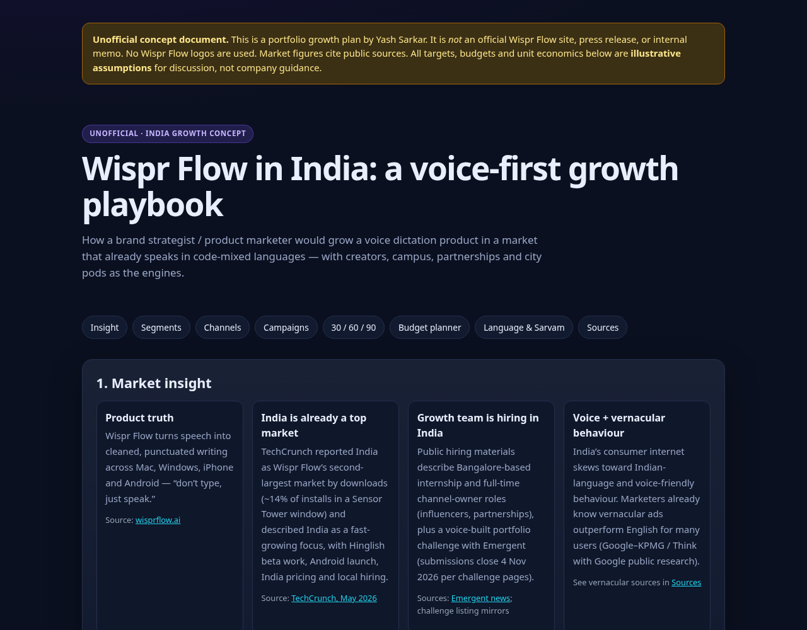

# Wispr Flow India Growth Playbook (unofficial)

**[Read it live](https://yashsarkar1806-creator.github.io/wispr-flow-india-growth-playbook/)** · a concept India growth plan for [Wispr Flow](https://wisprflow.ai/), written as a polished GitHub Pages briefing.



## What it is

An **unofficial**, clearly labelled growth concept covering:

- Market insight (public citations)
- Audience segments
- Channel system (creators, campus, partnerships, paid, city pods)
- Three campaign concepts
- A 30 / 60 / 90-day plan
- An **interactive channel budget planner** (illustrative INR)

## What it is not

- Not Wispr Flow’s website, brand system or official plan
- No official logos
- Targets and budgets are **illustrative assumptions**

## Why it matters for a marketer

It shows how a brand strategist / product marketer would structure India growth for a voice product: insight → segments → channels → campaigns → operating cadence → budget logic — with sources instead of vibes.

## Wispr Flow API note

Wispr Flow’s building API is **not publicly available** without enterprise approval ([docs](https://docs.wisprflow.ai/articles/2194989923-looking-to-connect-to-wispr-through-api)). This playbook treats Flow as the **product to grow**, and points to [Sarvam AI](https://docs.sarvam.ai) where Indian-language creative/CX tooling genuinely helps.

## Run locally

```bash
python3 -m http.server 8080
npm test
```

## License

MIT · Built by [Yash Sarkar](https://github.com/yashsarkar1806-creator). Not affiliated with Wispr Flow, Emergent or Sarvam AI.
